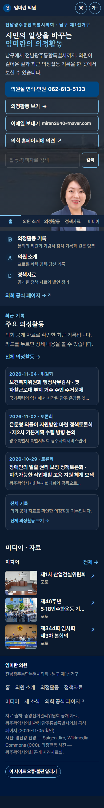
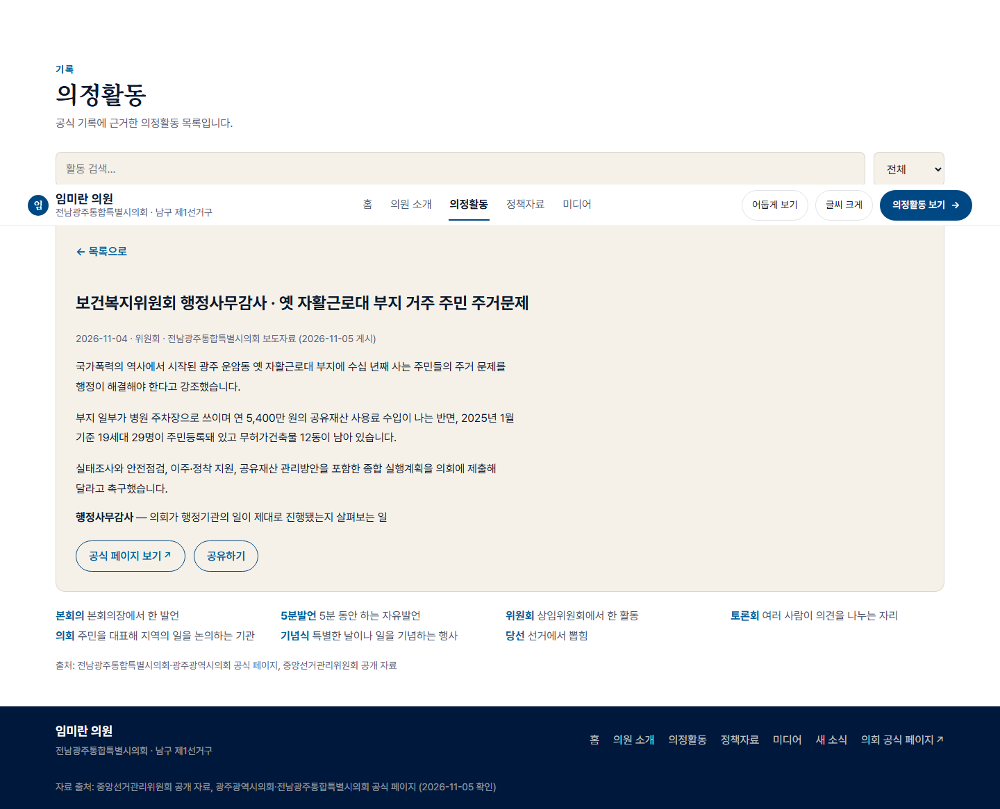
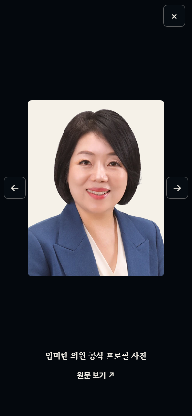
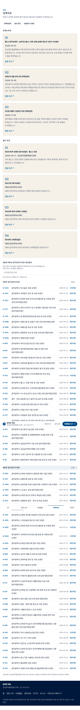

# CSS 분리 전후 화면 동일성 검증

- 기준 main: `0215a9c4` (의원 홈페이지 CSS 원본).
- 전체 **132개 상태**: 7쪽과 4개 펼침·상세 상태 × 폭 390·820·1440 × 밝게·어둡게 × 보통·큰 글씨.
- 보이는 요소 측정 **25,184개**, 요소별 계산 스타일 98개 속성 + 가상 요소 + 경계 직사각형.
- 계산 스타일·위치가 달라진 상태: **0/132**.
- 전체 화면 RGB 픽셀이 달라진 상태: **0/132**.
- 이미지·글꼴을 미리 불러오고 영상·애니메이션을 멈춘 뒤, 같은 Chromium 프로세스와 같은 URL에서 비교.
- 픽셀 비교에서 색상 보정·허용 오차·영역 마스킹은 사용하지 않음.
- 참고: 별도 브라우저 프로세스에서는 같은 사진 원본에서도 WebP 색 채널이 1~2단계 달라지는 비결정적 합성 현상을 확인했다. 최종 검증은 소프트웨어 합성 모드에서 실행해 이를 제거했다.
- 구형 `styles.css`의 `!important` 5개 모두 그대로 유지.
- 지운 낡은 주석 1건: `News reserves the common eyebrow line without adding any wording.`
- **삭제하지 않은 후보**: 실제 HTML·JS에서 사용이 확인되지 않은 `.policy-grid`, `.policy-card` 과거 별칭, 현재 600px 이하 1열인데 2열이라고 설명하는 미디어 주석. 이번 PR은 동작 보존을 위해 남겨 두었다.

## 화면 전후 예시

| 조건 | 수리 전 | 분리 후 | RGB 차이 |
|---|---|---|---:|
| home-390-dark-large |  |  | 0 |
| activity_detail-1440-light-normal |  |  | 0 |
| photo_viewer-390-dark-normal |  |  | 0 |
| policy_eighth_open-820-light-large |  |  | 0 |

기계 판독 가능한 전체 132개 결과는 `equivalence-summary.json` 참조.

## 기존 시험 동등성

- CSS 파일을 직접 읽던 시험 13곳을 공통 도우미로 전환했다. 검사 내용은 바꾸지 않았다.
- 기존 테스트 파일 14개를 실행해 **237개 통과, 1개 실패**.
- 실패한 `test_8740_text_size_261125.py::test_matrix_has_no_overflow_shift_or_header_break`는 원본 main에서도 같은 820px 밝게 의원 소개에서 **CLS 0.23014029423556276**으로 실패했다. 새 CSS 분리로 인한 회귀가 아니므로 기준이나 예외 처리를 변경하지 않았다.
- 새 구조 검증 10개도 통과했다.
