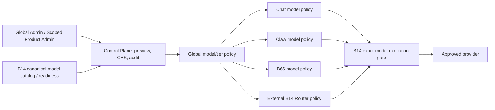

# PADIEM Model Control Center S1 — policy engine and guarded persistence contract

Issue [#4453](https://github.com/skerishKang/ai-revenue-lab/issues/4453); parent [#4428](https://github.com/skerishKang/ai-revenue-lab/issues/4428); predecessor [#4450](https://github.com/skerishKang/ai-revenue-lab/pull/4450).

**Status: SOURCE-ONLY S1. PRODUCTION=OFF. No B14 flags, Cloudflare secrets, Chat/Claw/B66 routes, membership, or admin UI were changed.**

## Authority and flow



- **One B14 model registration**: canonical model IDs, enabled state, owner-allowed, credential readiness, and capabilities are read from a *trusted projection* of B14. No duplicate model registration and no vendor request from policy evaluation.
- **Global vs local administrator**: global administrator may preview/apply all five logical scopes (central, chat, claw, b66, b14-router). Product administrator may preview/apply **only their designated single product**. An existing B66 product administrator does not become a global admin, and a browser's claimed role/owner/workspace has no authority. Trusted host MUST inject `VerifiedModelAdminGrant` after canonical identity, actual role and workspace verification.
- **Multiple models**: each `(workspace_id, product, tier, model_id)` row independently holds allow/block/inherit. Tiers FREE, PLUS, PRO, MAX; no single-model-per-tier ceiling. An inherit action removes an explicit row. Missing policies, invalid freshness or absent grants deny.
- **Effective authorization**: B14 registered AND enabled AND credential ready AND owner allowed, central tier-model explicit allow, product tier-model explicit allow, product capability/P01 and membership enforcement. Central block wins over product allow. No auto routing or silent fallback. `effective_model()` is an S1 value evaluator, not live B14 dispatch authority; S2 MUST enforce current grant and relevant product policies at server-side pre-dispatch.
- **Preview to apply**: 1–20 unique targets, exact owner-approved B14 IDs; immutable HMAC-SHA256 receipt binds tenant, operator, role scope, full diff, expected revision, random nonce and five-minute expiry. Caller cannot supply a server-admin grant as mere JSON. `SQLiteModelPolicyStore` is a **reference adapter only**, proving a single transaction for CAS revision, one-use nonce, rules, per-revision history and content-blind audit. Application defaults OFF unless host injects a trusted durable store and 32+ byte server-side signing secret and explicitly sets `enabled=True`.
- **Rollback**: explicit separately previewed and authenticated rollback, exactly one new immutable revision, tamper-resistant token, audit and CAS; large target diffs over 20 require reviewed smaller/manual migration. Restore does not bypass today's B14 status.
- **Exclusions**: no Secret values, prompts, output bodies, arbitrary owner identity, purchased tier grant, binary/attachment or billing authority stored. This does not automatically activate a model or raise execution timeout/token limits.

## Code

- `packages/padiem-control-plane/padiem_control_plane/model_assignment_policy.py`: typed policy changes, catalog projection, independent operator grants, effective reason resolution, signed diff/preview/confirm and guarded rollback.
- `packages/padiem-control-plane/padiem_control_plane/model_assignment_sqlite_reference.py`: stdlib local SQLite example for atomic CAS/replay/audit and deterministic integration tests. **It does not create Cloudflare D1 production tables or replicate B66 D1.**
- `packages/padiem-control-plane/tests/test_4453_model_assignment_policy.py`: denied-default, owner-allowlist, product scope, all tiers/multiple models, off-vs-on precedence, stale/replayed/forged/expired receipts, tenant boundaries, atomic persistence and rollback.

## Operator visual topology target (S2, not yet implemented)

Admin overview should show clickable scopes B14 / Control Plane / Chat / Claw / B66 / B14 Router and each scope's policy source. Per-model signal path must distinguish: registered, B14 enabled, credential ready, owner eligible, central global grant, product-tier grant, product capability, final dispatch HTTP/upstream code, last validated time. Never infer a green node from successful upstream registry GET alone. An unknown source renders **unknown/unavailable**, not OFF or zero. Product administrators can only inspect and edit their authorized scope. Global admin may inspect the cross-product view; changes are reviewed per-target with CAS/audit/rollback. Expose per-scope timeouts/output/token/rate limits only after their authoritative existing runtime configuration and precedence have been enumerated; no invented controls.

## S2 adapters required before production use

1. **Full B14 catalog projection**: serve registered and disabled models separately from existing ready selectable subset; B14 remains owner/credential authority. No new model list copied into product code.
2. **Canonical durable Control Plane store**: review Cloudflare D1/DO existing schema + migration and implement the atomic `DurableModelPolicyStore` adapter. Require actual global RBAC, separate product admin grants, authenticated server-side receipt exchange, CSRF and rate controls, audit retention. The current B62 global-admin Worker setting remains unprovisioned; never bypass it.
3. **Product adapters**: retain B66's D1 membership/revision/disabled-model policy while reconciling it explicitly; Chat legacy `model_profile_unassigned` and Claw P01 rules remain authority until reviewed change. Wire server-side admission to current global+product policy without introducing a user-controlled model fallback.
4. **Admin screens**: reuse deployed S0 `/admin-models.html`. Preview and diff → explicit confirmation → success/failure per target → audit → rollback. Add per-model and per-product flow/health view. Do not claim this S1 library has changed live UI.
5. **Proof**: test global/product admin role separation, B14 full vs selectable inventories, 2+ distinct scopes, no provider request on GET, one bounded authorized model completion, centralized OFF denial at actual B14 pre-dispatch, revision conflict and safe rollback, old B66 migration parity, no secret leakage and exact-head CI, then separate production release.

## Contract status

```
B14_CATALOG_REUSED=TRUSTED_INPUT_ONLY
CENTRAL_POLICY_STORE=SQLITE_REFERENCE_ONLY
PRODUCT_TIER_MODEL_GRANTS=SOURCE_ONLY
GLOBAL_OFF_PRIORITY=IMPLEMENTED
POLICY_REVISION_CAS=IMPLEMENTED_REFERENCE
PREVIEW_DIFF=IMPLEMENTED_SOURCE
APPLY_GATE=GUARDED_SOURCE_ONLY
AUDIT_RECEIPT=IMPLEMENTED_REFERENCE
ROLLBACK=GUARDED_SOURCE_ONLY
CROSS_PRODUCT_ISOLATION=TESTED_SOURCE
PRODUCTION=OFF
READY=NO
MERGED=NO
```
