# #5799 축사·인사말 운영 실측과 유틸 4종 비교 (2026-10-30)

- 측정: 아스트라5 레인(읽기·캡처 전용). 코드·CSS·운영 설정 변경 없음, 머지 없음.
- 대상: `https://chat.padiem.net/?theme=padiem-glass` 운영 서빙 화면, 로그아웃 상태.
- 기준: 이슈 #5799 본문 §구체 범위·§검증. 구현은 PR #5800(`f77ace12b`)·#6098(`f53fc1ac2`)·#6108(`c84e229d5`)로 머지·배포 완료된 상태.
- 저장소 기준: `main` = `09e601c9d7d4994412624b9efbd85d73eaf5c0a4`. 서빙된 `index.html`과 `util-menu.js`는 이 리비전과 바이트 단위 동일(각 sha256 앞 16자리 `497b8201e194e35b`, `1f834b45f6e12c94`).

## 0. 결론

| 질문 | 답 |
|---|---|
| 축사 화면은 이슈 기준을 충족하는가 | 충족. 기준 5항목 모두 PASS, FAIL 0. 세부 미확인 4건은 §5에 분리 |
| 축사 기준을 나머지 3종에 넓히면 무엇이 달라지는가 | 제목부 영문 라벨·설명 2줄, 입력 테두리 대비(PDF→Markdown 1.03:1 → 6.33:1), 라벨 굵기·색, 생성 버튼 색, 포커스 링 색 |
| SNS·회의정리 화면은 실측되었나 | 아니오. 두 화면은 운영에서 폼이 만들어지지 않음. 원인은 로그인이 아니라 `util-menu.js` 실행 오류 한 건(§4). 이 문서는 근거만 남기고 고치지 않음 |
| 로그인 없이 측정한 것이 충분한가 | 축사·PDF→Markdown은 충분. 저장된 축사 목록·생성/저장 실동작·결과 영역 버튼은 인증 필요(§5) |

## 1. 측정 방법

- 도구: 저장소의 기존 캡처 도구 `tools/beta-ux-capture.py`를 그대로 사용. 이 파일은 수정하지 않았고 새 도구도 만들지 않음.
- 그 도구의 상수는 뷰포트가 1440×1000과 390×844 두 개, 화면 함수는 speech·sns 두 개뿐이라 1920·820과 meeting·pdfmd는 그 모듈의 함수(`open_util`, `check`, `border_contrast`, `shot`, `tag_name`)를 import하는 임시 드라이버로 돌림. 드라이버는 저장소 밖에 있고 커밋하지 않음.
- 대비 수치는 도구 내장 `border_contrast()`의 픽셀 읽기(선언 색이 아니라 렌더링 결과)와 같은 계산식(`_luminance`, `_contrast_ratio`)을 사용. 배경 기준값은 화면 픽셀에서 읽은 `#eff3f4`(폼 패널 합성 배경).
- 줌 100%, deviceScaleFactor 1, 테마 4개 너비 모두 `padiem-glass`로 고정(제품 기본 테마와 동일 — `static/theme-init.js`).
- 캡처 전에 `#utilView` 스크롤을 0으로 되돌림. 유틸 화면은 자체 컨테이너가 스크롤되므로(`util-menu.css:8`) `full_page` 캡처만으로는 버튼 열이 잘려 나와서 상단/버튼 열 두 장을 각각 저장함.
- 생성·저장 버튼은 클릭하지 않음(운영 모델 호출과 파일 저장을 막기 위한 정지). hover·focus는 포인터·키보드 상태로만 측정.

## 2. 축사 기준 점검 (이슈 §구체 범위 + §검증)

| # | 항목 | 판정 | 실측 근거 | 캡처 |
|---|---|---|---|---|
| 1 | 제목부: 브랜드 dot + 영문 라벨 + 큰 한글 제목 + 짧은 설명 | PASS | dot 6×6px `rgba(121,188,231,.95)` radius 50% 표시됨 / 라벨 `Padiem Speech` 10px·600·자간 1.6px / 제목 `축사·인사말` 34px·770 / 설명 14px·400. 세 줄 시작 x가 1920=359, 1440=345, 820=33, 390=10으로 각 너비에서 일치 | `live-util-speech-{1920,1440,820,390}` |
| 2 | 입력 테두리 대비 | PASS | input·textarea·select 모두 테두리 `#56616b` vs 채움 `#ffffff` = **6.33:1** (비텍스트 기준 3:1 상회). 4개 너비 동일. hover `rgba(51,74,91,.58)`, focus `#79bce7` | `live-util-speech-1440`, `live-util-speech-820` |
| 3 | 초안 생성·저장 버튼 상태 | PASS (부분 미확인) | 초안 생성 `#79bce7` 배경 + 잉크 `#10202e` = 잉크 대비 **8.01:1**, hover `#8cc8ee`, 84×44. 저장 배경 `rgba(235,239,242,.46)` + 테두리 `rgba(51,74,91,.34)`(합성 `#afbac0`), 잉크 **14.48:1**, hover `rgba(121,188,231,.16)`, 72×44. 두 버튼 모두 포커스 시 outline 3px + 4px halo. 저장의 disabled 상태는 실측 불가 — 소스에 disabled를 주는 코드가 없고 빈 초안 가드는 `runSpeechSave()` 내부(§5-3) | `live-util-speech-actions-*`, `live-util-speech-focus-1440`, `live-util-speech-savefocus-1440` |
| 4 | 가로 넘침 | PASS | 4개 너비 × 4개 화면 모두 `scrollWidth == clientWidth`(1920/1440/820/390), 뷰포트를 넘는 요소 0개 | 모든 `live-util-*` 상단 캡처 |
| 5 | 390px 터치 영역 44px | PASS | 390에서 렌더링된 상호작용 요소 20개 전부 높이 ≥44px(입력 44, select 44, textarea 63·85·108, 초안 생성 44, 저장 44, 유틸 서브메뉴 44, `#mobileMenu` 44×44). 44 미만으로 잡힌 5개는 미렌더링 요소(§5-4) | `live-util-speech-390`, `live-util-speech-actions-390` |

집계: 기준 5항목 PASS 5 / FAIL 0 / 미확인 0. 항목 안에서 세부는 미확인 4건(§5).

## 3. 유틸 4종 비교표 (축사 = 기준)

값의 성격: **실측** = 운영 화면에서 렌더링 값을 읽음. **소스** = 화면이 열리지 않아 `util-menu.css`·`util-menu.js` 선언으로만 확인. **미확인** = 둘 다 불가.

| 비교 항목 | 축사·인사말 (기준) | SNS 홍보 | 회의정리·책 제작 | PDF → Markdown |
|---|---|---|---|---|
| 제목부 dot | 실측: 6×6px `rgba(121,188,231,.95)` | 같음(실측) | 같음(실측) | 같음(실측) |
| 영문 라벨(eyebrow) | 실측: `Padiem Speech` (탭별 고유값) | **다름**: 공통 기본값 `Padiem Util` | **다름**: `Padiem Util` | **다름**: `Padiem Util` |
| 큰 한글 제목 | 실측: 34px·770 (820=32.8px, 390=26px) | 같음 — 하나의 헤더를 4종이 공유 | 같음 | 같음 |
| 짧은 설명(tagline) | 실측: `행사에 맞는 축사·인사말 초안을 준비합니다` | **다름**: 공통 `AI 홍보·기록 비서` | **다름**: 공통 `AI 홍보·기록 비서` | **다름**: 공통 `AI 홍보·기록 비서` |
| 제목부 시작선 정렬 | 실측: 라벨·제목·설명 x 동일 | 같음 | 같음 | 같음 |
| 폼 분할(fieldset+legend) | 실측: 4분할 — 참고 글 / 기본 정보 / 내용 / 분량·말투·참고 | 미확인(폼 미빌드)·소스상 `util-fieldset` + legend `참고 글` 사용 | 미확인(폼 미빌드) | **해당 없음**: 자체 구조(`.pdfmd-header`·`.pdfmd-controls`·`.pdfmd-drop`)이고 fieldset 없음 |
| 입력 테두리 대비 | 실측: **6.33:1** (`#56616b` vs `#ffffff`) | 미확인·소스상 동일: 공통 `.util-form input`이 `--input-border-strong`을 같은 토큰에서 읽음(`util-menu.css:49` vs `:86`, glass에서 `#56616b`) | 미확인·소스상 동일 | **다름**: 실측 **1.03:1** — `.pdfmd-controls select`가 `var(--line)`를 써서 glass에서 `rgba(255,255,255,.38)`로 렌더링(`util-menu.css:351`) |
| 입력 채움색 | 실측: `#ffffff` | 미확인 | 미확인 | **다름**: `rgba(235,239,242,.46)` (반투명) |
| 라벨 텍스트 | 실측: `#334a5b` 13px·600 (합성 대비 8.28:1) | 미확인·소스상 동일 | 미확인·소스상 동일 | **다름**: `var(--muted)` 13px·400, 굵기 없음 |
| 생성 버튼 | 실측: 밝은 파랑 `#79bce7` + 잉크 `#10202e`, hover `#8cc8ee` | 미확인·소스상 **다름**: 공통 `.util-generate`는 `var(--accent,#6557e8)` 짙은 남색 계열(`util-menu.css:50,57`)이고 축사 오버라이드(`:92`)가 speech 스코프 한정 | 미확인·소스상 **다름** (동일 이유) | **해당 없음**: 생성 버튼 없음(업로드·변환 흐름) |
| 보조 버튼(저장) | 실측: 테두리 `rgba(51,74,91,.34)`, 배경 46% 옅은 회색 | 미확인 | 미확인 | **다름**: `.pdfmd-btn` 테두리 `var(--line)` + 단일 버튼 비활성 라벨 `내 PC에서 가져오기 · 준비 중`(disabled=true) |
| 포커스 링 | 실측: outline 3px `rgba(121,188,231,.42)` + halo 4px, 테두리 `#79bce7`(채움 대비 2.07:1) | 미확인 | 미확인 | **다름**: `--focus-ring` 기본 `rgba(101,87,232,.24)` — 남보라 계열(`util-menu.css:367`) |
| 터치 44px | 실측: 전부 ≥44px | 미확인 | 미확인 | 실측: select 44, 버튼 44, 드롭 150 → 통과 |
| 가로 넘침 | 실측: 없음 | 실측: 없음 | 실측: 없음 | 실측: 없음 |
| 화면 상태 | 폼 전체 렌더링 | **폼 미빌드**(§4) | **폼 미빌드**(§4) | 렌더링됨 + 운영 안내 `문서 처리 서버를 COM2로 이전 중입니다…`, 드롭 영역 클래스 `pdfmd-paused` |
| 사이드바 표기 vs 페이지 제목 | 축사·인사말 = 축사·인사말 | SNS 홍보 = SNS 홍보 | **다름**: 사이드바 `회의정리·활동집`, 페이지 제목 `회의정리·책 제작` | PDF → Markdown = PDF → Markdown |

확장 판단에 바로 쓰이는 요약:
1. 제목부에서 축사만 고유한 값은 `data-kicker`·`data-tagline` 두 속성이고, 나머지 3종은 `util-menu.js:851-852`의 공통 기본값으로 떨어진다. dot·제목 타이포·정렬은 이미 4종 공유.
2. 입력 테두리는 glass 테마에서 공통 클래스가 같은 토큰을 읽으므로, 축사 스코프 규칙을 걷어내도 SNS·회의정리는 같은 대비가 나온다. 실제 격차는 PDF→Markdown의 자체 `.pdfmd-*` 규칙에서 발생(측정 1.03:1).
3. 버튼 색 차이는 `.util-generate`의 speech 스코프 오버라이드에서 발생. 확장 여부는 "짙은 남색을 남길지 밝은 파랑으로 통일할지"의 한 가지 결정으로 모인다.

## 4. 실측 중 확인된 운영 실행 오류 1건 (수정하지 않음)

- 증상: 유틸에서 **SNS 홍보**·**회의정리·책 제작** 탭을 열면 폼 대신 정적 플레이스홀더 한 줄만 남는다. 패널 자식 1개, `p.util-soon-msg`, 텍스트 `SNS 홍보 화면을 열 수 없습니다.` / `회의정리·책 제작 화면을 열 수 없습니다.` 패널 높이 66px(1920·1440), 157px(820), 136px(390).
- 1차 증거: `live-util-sns-*.png`, `live-util-meeting-*.png` 4종 8장.
- 원인 위치: `apps/padiem-chat/static/util-menu.js:1507`(SNS)과 `:1787`(회의정리).
  `form.insertBefore(snsSaveState, formActions)`가 `formActions`를 `form`에 붙이기(`:1508`) **전에** 참조 노드로 쓰기 때문에 `NotFoundError`가 난다. 브라우저에서 읽은 스택:
  `NotFoundError: Failed to execute 'insertBefore' on 'Node': The node before which the new node is to be inserted is not a child of this node. at buildSns (util-menu.js:1507:12) at activateUtilTab (util-menu.js:855:41)`
- 재시도로 복구되지 않음: `buildSns()`가 진입 첫 줄에 `panel.dataset.loaded = "1"`을 세팅한 뒤 예외로 빠져, 같은 세션에서 탭을 다시 눌러도 함수가 즉시 return한다(관측: 두 번째 클릭 후에도 자식 1개 유지).
- 도입 시점: `git blame` = `bf1cca90e` `feat(5783): 저장 실패를 탭 안 상태 줄로 말하고 회의정리에도 고쳐 쓰기를 연다 (#6257)`, 2026-10-30 06:29 +0900. 직전 리비전 `bf1cca90e^`에는 `insertBefore`가 축사 경로 한 곳(`:859`)뿐이고 그 축사 경과는 부모 존재를 확인한 뒤 호출한다(`:940-941`).
- 로그인과 무관함: 로그아웃 상태에서 정적 HTML과 `util-menu.js`는 `main`과 바이트 동일하고, 실패 지점은 인증 응답이 아니라 DOM 생성 코드다. 저장소의 기존 캡처 도구 `capture_sns()`를 운영에 그대로 돌려도 `#utilSnsForm` 대기 5초 타임아웃으로 동일하게 실패함(교차 확인).
- 이 레인은 읽기 전용이라 **수정하지 않았음.** 처리 판단과 실행은 CTO.

## 5. 로그인 또는 초안 생성 없이는 확인할 수 없었던 항목

| # | 항목 | 상태 | 사유 |
|---|---|---|---|
| 1 | 저장된 축사 목록 복원(#5731) | 미확인 | `#utilSpeechSaved` 자식 0개. 목록은 `ensureProject()` → `/api/auth/status` 결과에 달렸고, 로그아웃에서는 그 호출이 500으로 돌아옴. 빈 목록과 미로딩을 화면으로 구분할 수 없음 |
| 2 | 초안 생성 실동작과 결과 영역(복사·TXT 다운로드) | 미확인 | 운영에서 생성을 누르면 모델 호출과 과금이 발생하므로 누르지 않음 |
| 3 | 저장 실동작·저장됨 표시·409 새 이름/덮어쓰기 | 미확인 | 파일 저장副作用. `#utilSpeechSave`는 `disabled` 속성 없이 항상 활성 렌더링되고(관측: `disabled=false`, `aria-disabled=null`), 빈 초안 가드는 `runSpeechSave()`의 조기 return이라 시각 상태로는 확인되지 않음 |
| 4 | 결과 영역 버튼 4종(복사·TXT 다운로드·내 PC에 저장·다시 시도)의 390px 터치 크기 | 미확인 | 초안이 있어야 렌더링되어 390 실측에서 미렌더링 5개에 포함됨 |

## 6. 캡처 파일

`assets/util-capture-20261030/` 아래 27장. 200KB를 넘는 PNG는 JPG 품질 80으로 저장(14장), 이하는 PNG 유지(13장). 원본 이름과 저장 이름의 대응은 `capture-manifest.json`에 있음.

| 접두 | 내용 | 너비 |
|---|---|---|
| `live-util-speech-*` | 축사 화면 상단(제목부·참고 글·기본 정보) | 1920×1080, 1440×1000, 820×1180, 390×844 |
| `live-util-speech-actions-*` | 축사 화면 하단(분량·말투·참고 + 초안 생성/저장 열) | 위 4종 |
| `live-util-sns-*` / `live-util-meeting-*` | SNS·회의정리 화면(§4의 플레이스홀더 상태) | 위 4종 |
| `live-util-pdfmd-*` / `live-util-pdfmd-actions-*` | PDF→Markdown 화면 상단·하단 | 위 4종 |
| `live-util-speech-focus-1440`, `live-util-speech-savefocus-1440`, `live-util-speech-focus-390` | 포커스 링 상태(초안 생성 / 저장) | 1440, 390 |

모든 캡처는 로그아웃 상태의 공통 셸(사이드바·계정 `게스트`)을 포함하며 계정 정보·개인 데이터·비밀 값은 없음.

### 축사·인사말 (기준 화면)

| 1920 | 1440 | 820 | 390 |
|---|---|---|---|
| 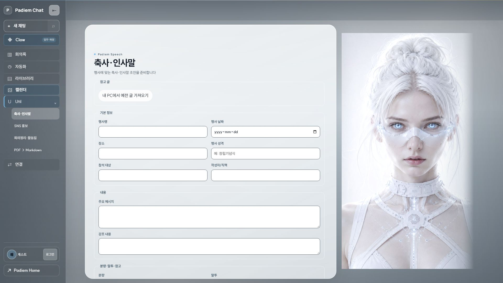 | 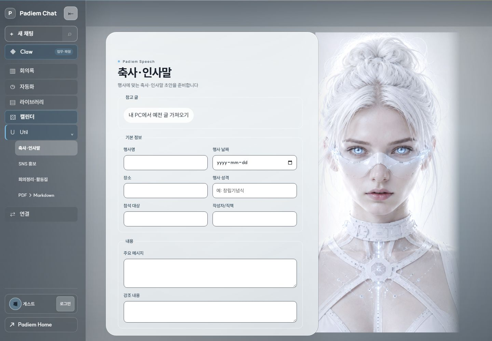 | 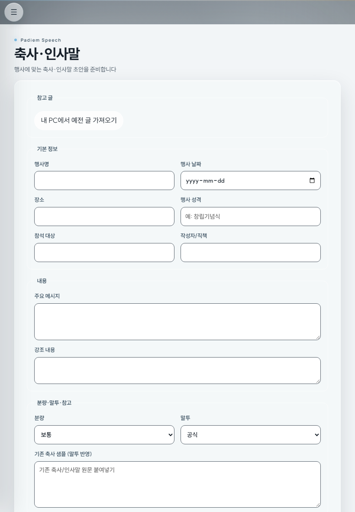 | 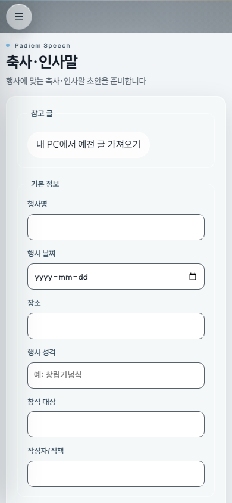 |
| 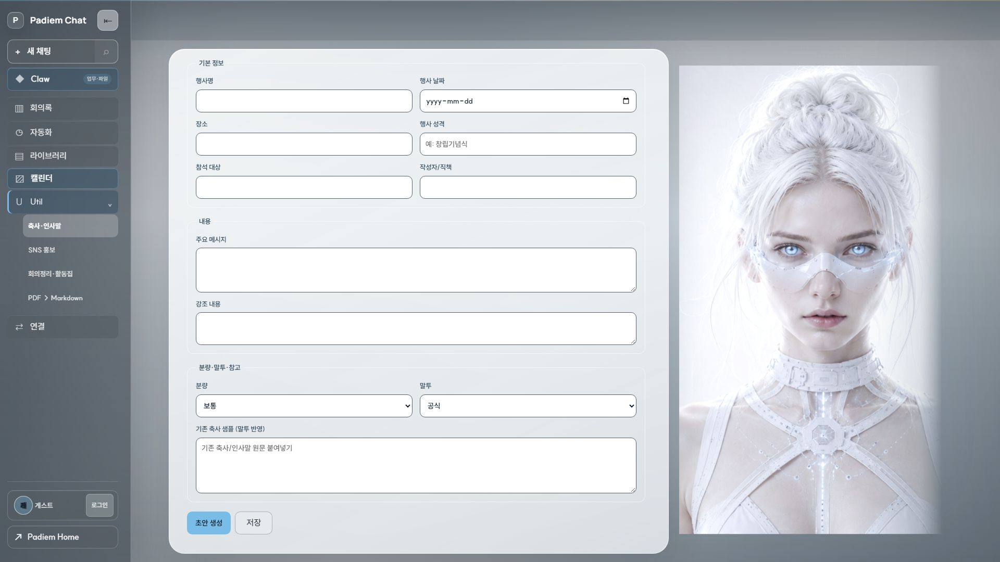 |  | 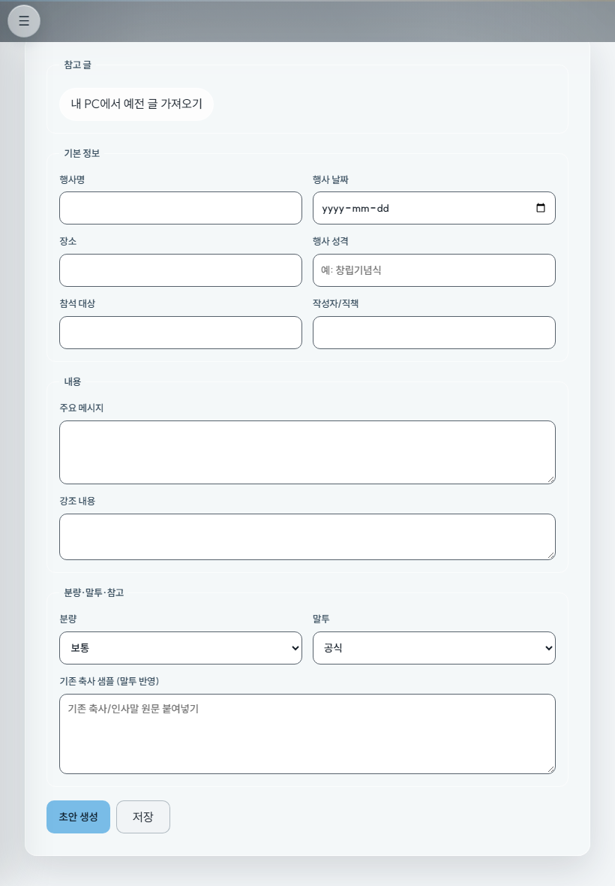 | 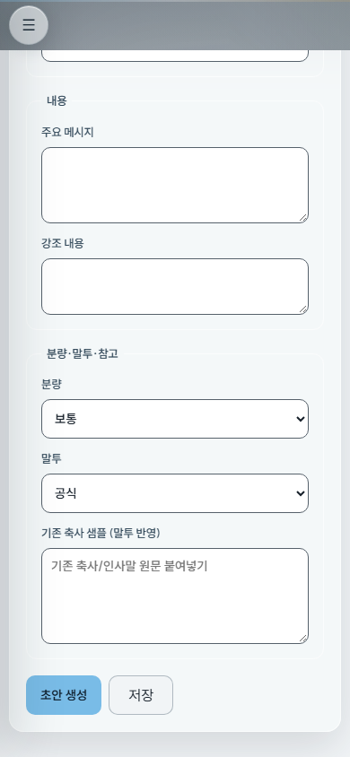 |

위 열이 제목부·기본 정보, 아래 열이 분량·말투·참고와 `초안 생성`/`저장` 버튼 열.

### 나머지 3종 (1440)

| SNS 홍보 | 회의정리·책 제작 | PDF → Markdown |
|---|---|---|
| 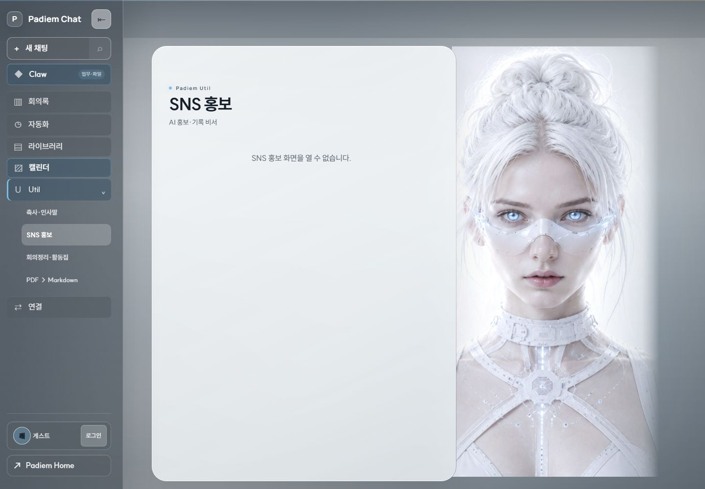 | 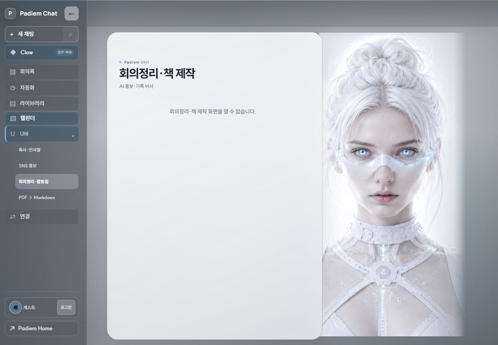 | 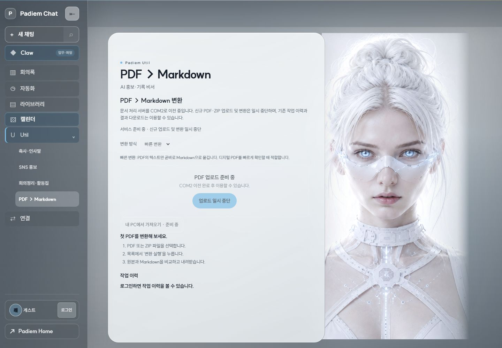 |

SNS·회의정리의 빈 패널은 §4의 실행 오류 결과이고, 두 화면의 390·820·1920 캡처도 같은 상태를 보여준다.

### 버튼 포커스 상태 (1440)

| 초안 생성 포커스 | 저장 포커스 |
|---|---|
|  | 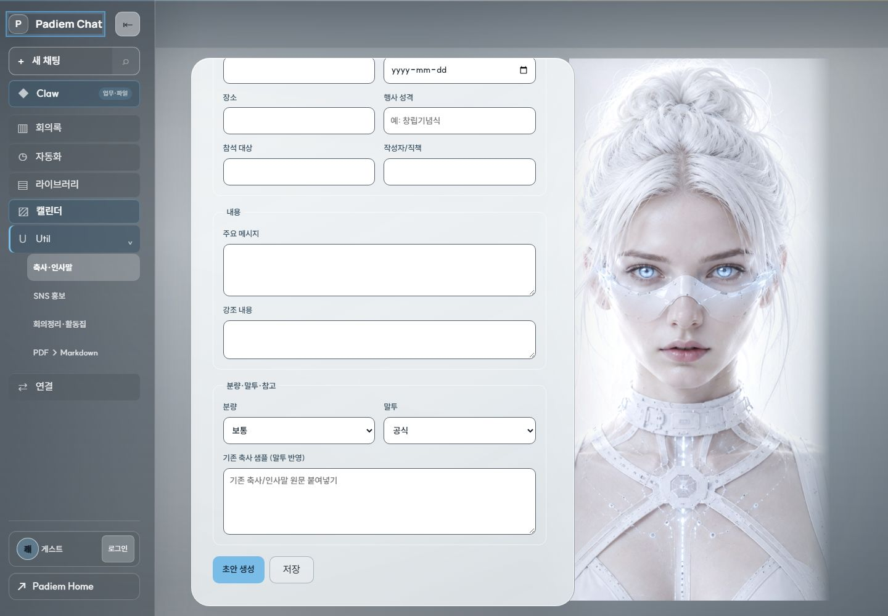 |

## 7. 기계 판독 근거

- `assets/util-capture-20261030/metrics.json` — 위 모든 표의 입력값. 화면별 헤더·dot·테두리 대비·버튼 rect/색·넘침·터치 감사·포커스/ hover 상태·§4의 오류 스택까지 포함.
- `assets/util-capture-20261030/capture-manifest.json` — 파일별 원본 PNG/저장 파일명과 크기.

## 8. 이 문서가 하지 않은 일

- 코드·CSS·운영 설정 변경, 배포, 머지, 이슈 상태 변경.
- 로그인 시도, 비밀번호 입력, 초안 생성·저장 실행.
- 나머지 3종 스타일 수정. §3은 대표가 "축사 기준을 넓힐지" 판단하기 위한 자료이고, 확장 지시나 승인 요청은 이슈 #5799 §단계별 보고 4가 이미 별도 단계로 못 박아 둔 사안임.
