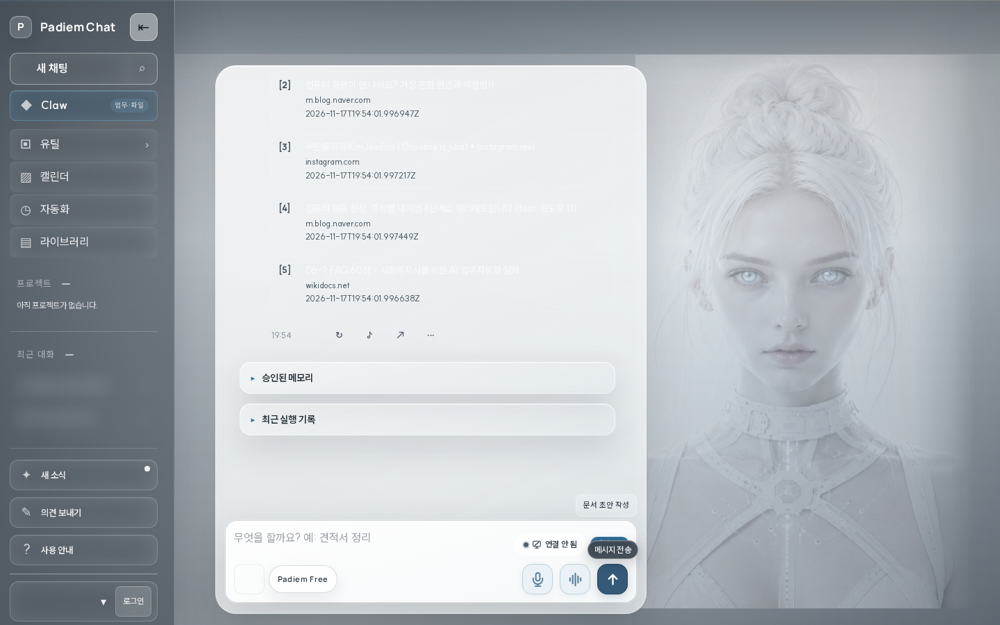
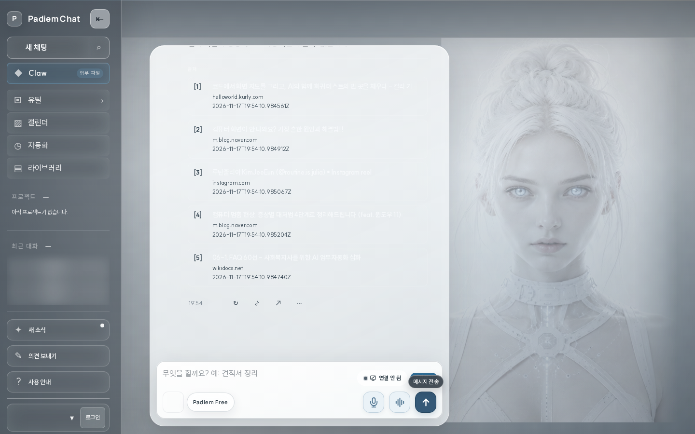

# Claw로 작업 요청하고 결과 받기

이 문서는 매일 실사용 점검 실행에서 자동으로 만든 초안입니다.

## 1. Claw 작업영역

사이드바에서 Claw 작업영역을 연다.

## 2. 작업 요청 입력

Claw에 작업을 요청한다.

## 3. 작업 결과 표시

작업 결과가 화면에 표시될 때까지 기다린다.

## 걸린 시간

- 전체: 6809 ms
- 화면 진입: 80 ms
- 질문에서 답까지: 5041 ms
