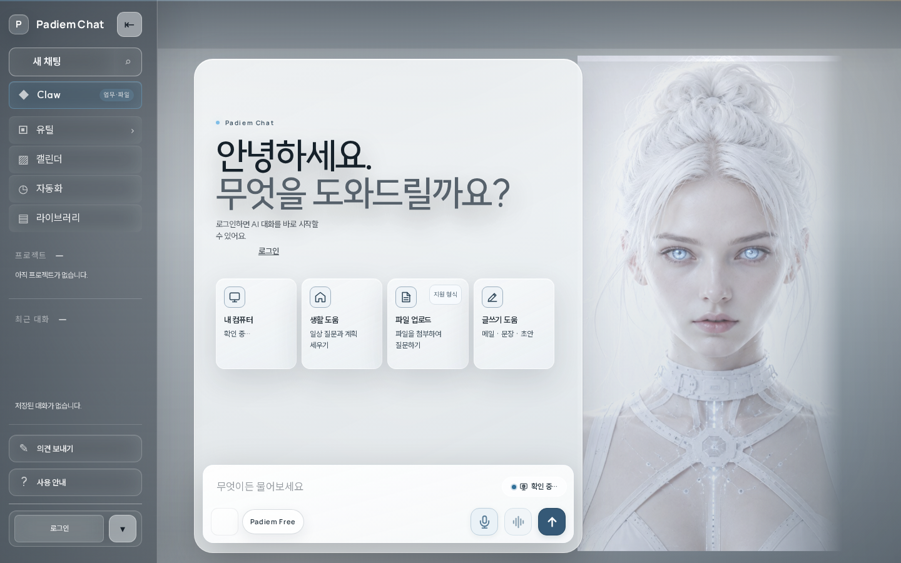
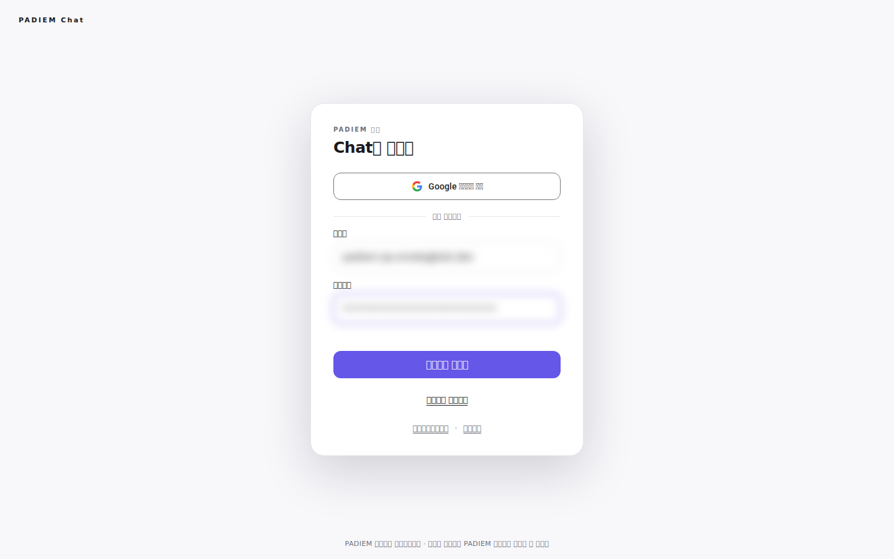
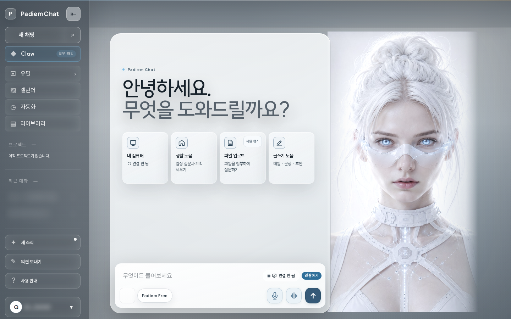

# 공통 로그인으로 들어가고 나오기

이 문서는 매일 실사용 점검 실행에서 자동으로 만든 초안입니다.

## 1. Chat 첫 화면

공통 로그인 전 Chat 첫 화면이 열린다.

## 2. 공통 로그인 화면

padiem-auth 이메일 로그인 화면으로 이동한다.

## 3. 로그인 완료

로그인을 마치고 Chat으로 돌아온 화면이다.

## 걸린 시간

- 전체: 15649 ms
- 화면 진입: 4890 ms
- 질문에서 답까지: 234 ms
